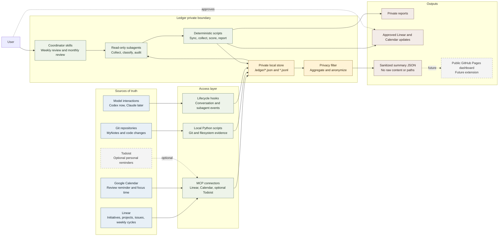
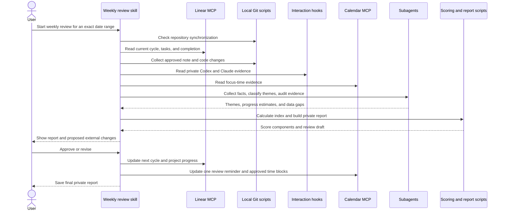

# Ledger Architecture

Ledger is a private evidence and review layer. Linear owns plans and progress,
Google Calendar owns scheduled and actual time, and Git repositories own notes
and code history. Ledger reads those systems, produces reviews, and writes back
only after approval.

## System map

## Weekly run

## Ownership rules

| Concern | Owner | Ledger behavior |
| --- | --- | --- |
| Weekly tasks | Linear cycle and issues | Read completion; preview writes |
| Work themes | Linear projects | Link evidence and summarize progress |
| Long-term goals | Linear initiatives or projects | Review monthly |
| Scheduled and actual time | Google Calendar | Read focus time; write approved blocks only |
| Notes | MyNotes Git history | Read approved paths and diffs |
| Code activity | Local Git history | Read commits and diffs across configured identities |
| Model interactions | Local hooks and exports | Keep raw text private |
| Weekly index | Ledger scripts | Calculate deterministically from reviewed inputs |
| Public dashboard | Sanitized aggregates only | Never receive raw paths, prompts, titles, or notes |

## Trust boundaries

1. Raw evidence stays in `.ledger/` and is never committed.
2. MCP credentials stay in the connector authorization layer, not in this repository.
3. Subagents are read-only; the coordinator performs approved external writes.
4. Missing data is reported as unknown, not treated as zero progress.
5. Todoist is optional and must not duplicate Linear's weekly plan.
6. Public export is a separate explicit action after privacy filtering.
